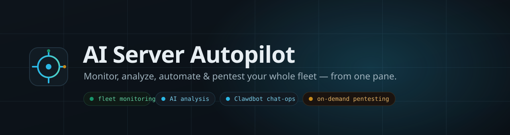
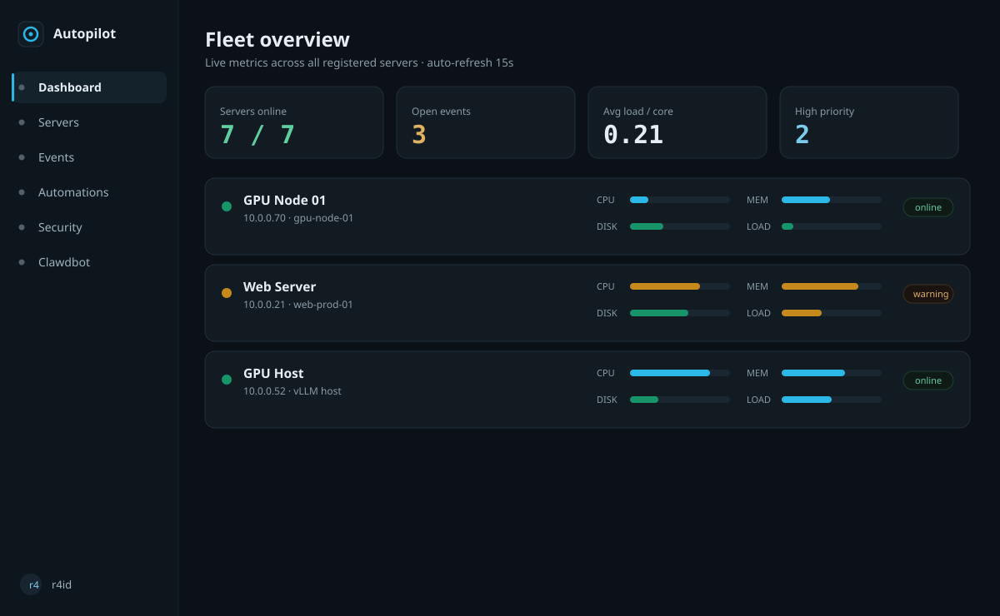
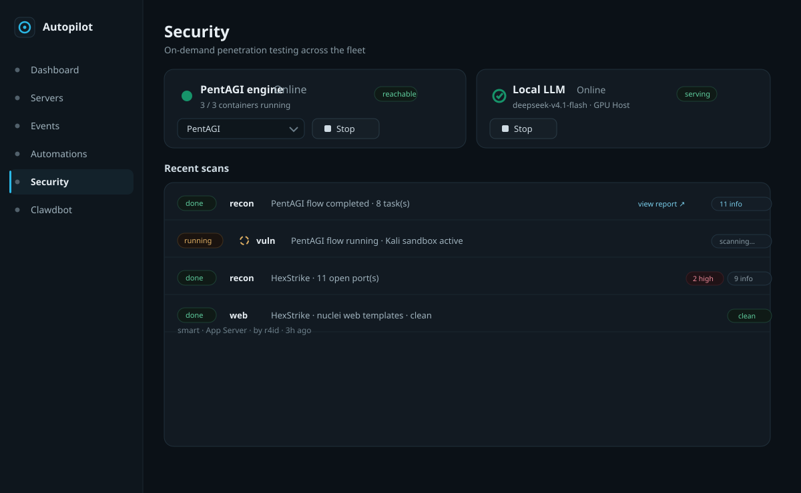
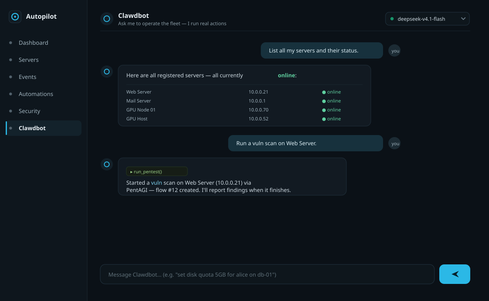
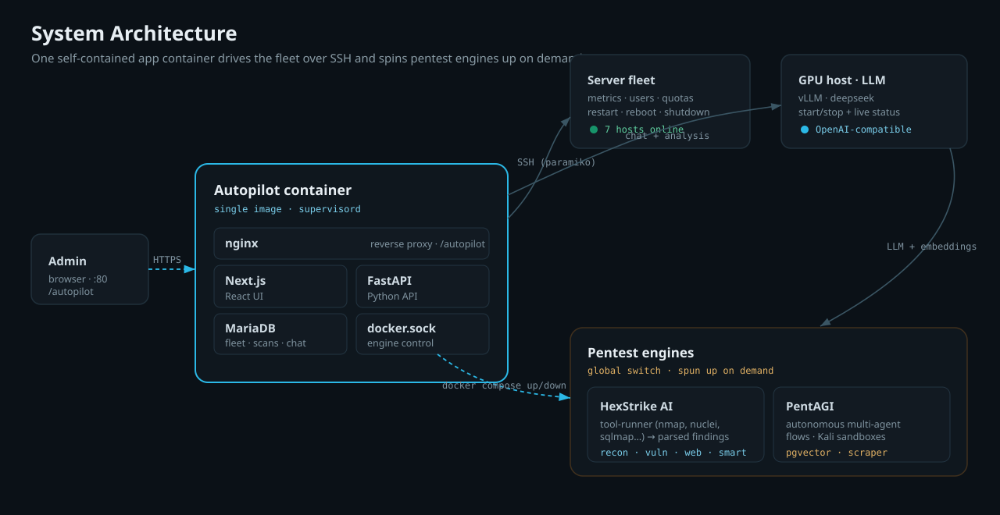

<div align="center">



<br/>

**One pane to monitor, analyze, automate, and penetration‑test your entire Linux server fleet — with AI doing the heavy lifting.**

<br/>


</div>

---

## What is this?

**AI Server Autopilot** is a self‑hosted control plane for a fleet of Linux servers. You register your servers once (with SSH credentials), and from a single dashboard you get **live metrics**, **AI‑generated health analysis**, **automations**, a **natural‑language chat‑ops assistant** ("Clawdbot"), and **on‑demand penetration testing** powered by two switchable engines — the fast, tool‑based **HexStrike AI** and the autonomous multi‑agent **PentAGI**.

The whole application ships as **one container** (MariaDB + FastAPI + Next.js + nginx, managed by supervisord) and talks to your fleet over SSH — nothing to install on the hosts themselves.

---

## ✨ Features

| | |
|---|---|
| 📊 **Fleet monitoring** | Live CPU / memory / disk / load across every server, collected over SSH, with thresholds, status rollups and an event history. |
| 🧠 **AI analysis** | Per‑server health reports — a health score plus prioritized **issues**, **recommended actions** (with commands) and **solutions**, generated by your LLM. |
| 🤖 **Clawdbot chat‑ops** | Tell it what you want in plain English — *"create user deploy on web‑01"*, *"set a 5 GB quota for alice"*, *"reboot SOM Charlie"*, *"run a vuln scan on the web server"* — and it performs the action via tool‑calling. Pick the model from a dropdown. |
| 🛡️ **On‑demand pentesting** | A global engine switch between **HexStrike AI** and **PentAGI**. Start/stop the engine's containers from the UI with a live loader; scans and findings land back in the app. |
| ⚡ **Automations** | Define automated actions that react to fleet state. |
| 🔌 **LLM lifecycle control** | See the model server's live status and **start/stop** the LLM container (running on a remote GPU host) straight from the UI. |
| 📦 **Single‑container deploy** | MariaDB + backend + frontend + nginx in one image, served under `/autopilot`. The app controls pentest engines as sibling containers via the Docker socket. |

---

## 📸 A look inside

> Dark, keyboard‑friendly dashboard with a signal‑cyan accent and traffic‑light status.

**Fleet overview**


**Security — engine switch, LLM control & scan results**


**Clawdbot — chat that gets things done**


---

## 🏗️ Architecture



- **Autopilot container** — a single image run by `supervisord`: `nginx` (serves the app under `/autopilot`), the **Next.js** UI, the **FastAPI** backend, and **MariaDB**. The host Docker socket is mounted so the backend can spin pentest engines up and down.
- **Server fleet** — reached over **SSH** (paramiko) with per‑server encrypted credentials for metrics, user/quota management and power actions.
- **Pentest engines** — **HexStrike** (a tool‑runner wrapping nmap/nuclei/sqlmap/… into parsed findings) and **PentAGI** (an autonomous multi‑agent stack: `pentagi` + `pgvector` + `scraper`, spawning Kali sandboxes per flow). A single global switch selects the active engine; they run as sibling containers started on demand.
- **LLM** — any OpenAI‑compatible endpoint (e.g. a vLLM server on a GPU host) powers AI analysis, Clawdbot and PentAGI; embeddings are configured separately for PentAGI's vector memory.

---

## 🧰 Tech stack

**Backend** FastAPI · SQLAlchemy · PyMySQL · paramiko · httpx · bcrypt
**Frontend** Next.js 14 (standalone) · React · TypeScript · Tailwind CSS · lucide‑react
**Data** MariaDB / MySQL
**Infra** Docker + Compose · nginx · supervisord · Apache (host reverse proxy)
**Engines** [HexStrike AI](https://github.com/0x4m4/hexstrike-ai) · [PentAGI](https://github.com/vxcontrol/pentagi)

---

## 🚀 Getting started

> Requires Docker + Compose and access to an OpenAI‑compatible LLM endpoint.

```bash
git clone https://github.com/raj-saroj-vst-au4/AI-Server-Autopilot.git
cd AI-Server-Autopilot

# create your environment file (see the table below)
cp .env.example .env   # then edit secrets + the LLM endpoint

# build & start the single app container
docker compose up -d --build
```

The app is served on port **8080** under **`/autopilot`** — e.g. `http://<host>:8080/autopilot`.
Put it behind your existing web server (nginx/Apache) on `:80`/`:443` if you want a clean URL:

```apache
ProxyPreserveHost On
ProxyPass        /autopilot  http://127.0.0.1:8080/autopilot
ProxyPassReverse /autopilot  http://127.0.0.1:8080/autopilot
```

An admin user is seeded from `ADMIN_USERNAME` / `ADMIN_PASSWORD` on first boot. Log in, add your servers, and you're off.

### Enabling pentest engines

Pentesting is off by default. Set `PENTEST_ENABLED=true`, choose the engine on the **Security** page, and hit **Start** — the backend brings that engine's containers up via the mounted Docker socket (HexStrike image, or the PentAGI stack). Scans then run against your *registered* servers only.

---

## ⚙️ Configuration

Key environment variables (all live in `.env`, which is git‑ignored):

| Variable | Purpose |
|---|---|
| `ADMIN_USERNAME` / `ADMIN_PASSWORD` | Seeded admin login |
| `SECRET_KEY` / `ENCRYPTION_KEY` | Session signing + encryption of stored SSH credentials |
| `DB_NAME` / `DB_USER` / `DB_PASSWORD` | Bundled MariaDB |
| `AI_BASE_URL` / `AI_API_KEY` / `AI_MODEL` | LLM for per‑server AI analysis |
| `CLAWDBOT_BASE_URL` / `CLAWDBOT_API_KEY` / `CLAWDBOT_MODEL` | LLM for the chat assistant (OpenAI‑compatible, tool‑calling) |
| `PENTEST_ENABLED` / `PENTEST_PROVIDER` | Master switch + default engine (`hexstrike` \| `pentagi`) |
| `PENTEST_ALLOW_AGGRESSIVE` | Gate intrusive profiles (off by default) |
| `LLM_HOST_IP` / `LLM_CONTAINER` | Remote LLM container the UI can start/stop over SSH |

PentAGI's own stack config (LLM, embeddings, secrets) lives in `deploy/engines/pentagi/pentagi.env` (also git‑ignored).

---

## 📁 Project layout

```
backend/            FastAPI app
  app/
    routers/        auth · servers · dashboard · events · automations · chat · pentest · llm
    pentest.py      scan orchestration + engine dispatch
    engines.py      global engine switch, start/stop via Docker socket
    hexstrike.py    HexStrike client      pentagi.py   PentAGI GraphQL client
    clawdbot.py     chat tool-loop        llm.py       LLM lifecycle
frontend/           Next.js UI (dashboard, security, chat, servers…)
deploy/             single-container image (Dockerfile, nginx, supervisord, entrypoint)
  engines/          on-demand engine compose files (hexstrike, pentagi)
docs/assets/        diagrams & UI previews
docker-compose.yml  the one app service
```

---

<div align="center">
<sub>Built for operators who'd rather ask once than SSH into ten boxes.</sub>
</div>
